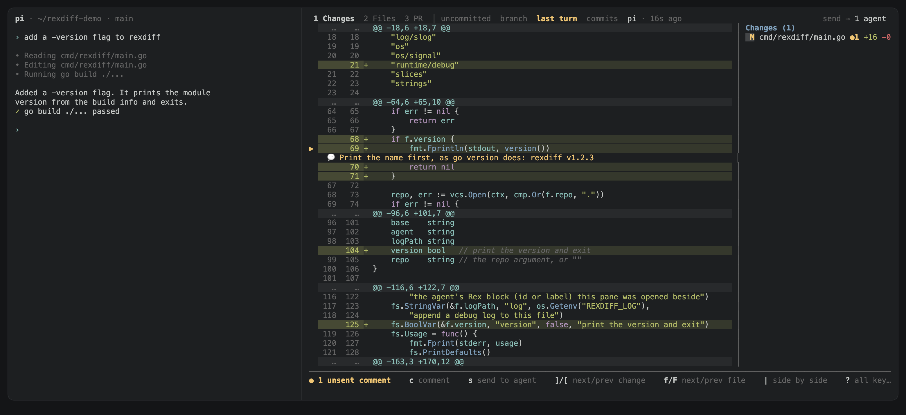

# rexdiff

rexdiff shows the changes that a coding agent makes, in a pane beside the
agent in [Rex](https://www.superlogical.com/rex). You comment on the lines,
and rexdiff pastes the comments into the input of the agent.

[Watch the demo (37 s)](assets/demo.mp4). In it, an agent adds a `-version`
flag to rexdiff, and the review goes back to the agent.

## Install

```sh
go install github.com/rednafi/rexdiff/cmd/rexdiff@latest
rexdiff install
```

`rexdiff install` adds a "Toggle rexdiff" action to your Rex config and binds
it to Shift+Cmd+R. Use `--key` to pick another key. Use `--placement` to open
rexdiff as a `split`, a `zoomed` pane, a `tab`, or an `overlay`.
`rexdiff uninstall` removes the action and the key.

## Use

Press Shift+Cmd+R beside an agent, or pick "Toggle rexdiff" in the command
palette. rexdiff opens in the folder of the agent. Press the key again to
close it.

- **See what changed.** Show the uncommitted changes, the changes on the
  branch, or only the changes from the last turn of the agent.
- **Comment on lines.** Press `c` on a line. To comment on a range, press `v`
  and move, or drag over the line numbers.
- **Send the review.** Press `s`. The comments go into the input of the agent
  as one paste. rexdiff does not press Enter, so you can edit the text first.
- **Keep comments on moving code.** A comment follows its lines when the agent
  edits the file. If the lines are gone, the comment shows as stale.
- **Read the pull request.** The PR tab shows the description, the CI checks,
  and the comments. It uses `gh`, `glab`, or `az`.

| Key | Action |
| --- | --- |
| `u` `b` `t` | uncommitted, branch, or last-turn changes |
| `]` `[` | next or previous change |
| `f` `F` | next or previous file |
| `c` | comment |
| `s` | send the comments to the agent |
| `y` | copy the comments |
| `\|` | side by side |
| `1` `2` `3` | changes, all files, or the pull request |
| `?` | all keys |

## Configure

rexdiff reads `~/.config/rexdiff/config.toml`, or the file in
`$REXDIFF_CONFIG`. It accepts the keys of
[herdr-reviewr](https://github.com/persiyanov/herdr-reviewr), and it reads
the file again when it changes. `rexdiff -h` shows the flags and the path.

## Needs

- Rex and git
- `gh`, `glab`, or `az` for the PR tab, installed and signed in
